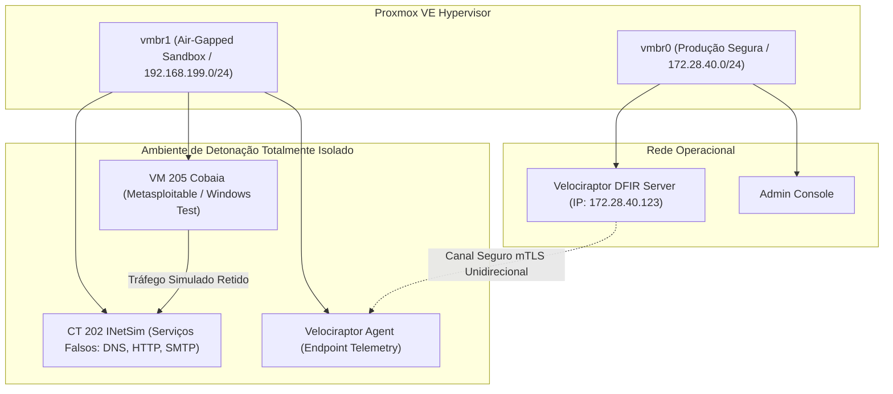

# 🛡️ Cyber DFIR Training Lab & Purple Team Automation

[](https://lessa-github.github.io/cyber-dfir-training-lab/)
[](https://attack.mitre.org)
[](https://docs.velociraptor.app)
[](https://lessa-github.github.io/gabriel-portfolio/)

Plataforma de Forense Digital, Resposta a Incidentes (DFIR) e simulação de adversários automatizada, construída em ambiente isolado no Proxmox VE.

O laboratório permite **detonar malwares em sandbox air-gapped (`vmbr1`) e validar 344 técnicas MITRE ATT&CK** sem depender de SIEMs pesados baseados em Java ou Elasticsearch que exaurem o hardware do laboratório.

---

## ⚡ Destaque de Engenharia: DFIR com 67 MB de RAM

Enquanto clusters convencionais de Wazuh, Elastic Security ou Splunk exigem entre **4 e 8 GB de RAM** apenas para manter a esteira básica de ingestão de logs funcionando, este laboratório adota uma abordagem moderna e enxuta:
* **Velociraptor Server:** Compilado em binário estático Go para Linux musl, consumindo exatamente **67 MB de RAM física**.
* **Consultas VQL (Velociraptor Query Language):** Caça a anomalias em velocidade de memória diretamente nos endpoints, coletando apenas os deltas e artefatos necessários.
* **Redução Drástica de Armazenamento:** Elimina terabytes de índices de logs ruidosos; os artefatos são puxados sob demanda via queries expressivas.

```
┌────────────────────────────────────────────────────────────────────────┐
│             COMPARATIVO DE CONSUMO DE RECURSOS EM HOMELAB              │
├────────────────────────┬─────────────┬─────────────┬───────────────────┤
│ Solução                │ RAM em Idle │ CPU Médio   │ Armazenamento Mês │
├────────────────────────┼─────────────┼─────────────┼───────────────────┤
│ Wazuh + Elasticsearch  │ ~6.200 MB   │ 12-25%      │ ~45 GB (Índices)  │
│ Splunk Enterprise      │ ~4.800 MB   │ 10-18%      │ ~60 GB (Indexed)  │
│ Velociraptor (Go Core) │ 67 MB       │ < 1.5%      │ < 2 GB (Raw DFIR) │
└────────────────────────┴─────────────┴─────────────┴───────────────────┤
  Economia de Hardware: 98.9% de redução de memória RAM física!
```

---

## 📐 Topologia da Sandbox Air-Gapped (`vmbr1`)



---

## 🎯 Purple Teaming & Cobertura MITRE ATT&CK

A esteira de testes automatizada dispara técnicas controladas do **Atomic Red Team** com garantia de auto-limpeza (`cleanup` pós-execução):

| Tática MITRE | Técnica Testada | Artefato de Caça VQL |
| :--- | :--- | :--- |
| **Execution** | T1059.001 (PowerShell Obfuscated) | `Generic.Client.ProcessTracker` |
| **Persistence** | T1547.001 (Registry Run Keys) | `Windows.Sys.Autoruns` |
| **Privilege Escalation** | T1068 (Kernel Exploits / Token Impersonation) | `Linux.Sys.PrivilegeAudit` |
| **Defense Evasion** | T1070.004 (File Deletion / Timestomp) | `Windows.NTFS.MFT` / `Linux.Search.FileFinder` |
| **Credential Access** | T1003.001 (LSASS Memory Dumping) | `Windows.Detection.MemoryInjection` |
| **Discovery** | T1082 (System Information Discovery) | `Generic.System.Info` |

---

## 🛠️ CLI Orchestrator: `homelab-soc.py`

O utilitário CLI automatiza a simulação e a resposta forense:

```bash
$ python3 purple-team-automation/homelab-soc.py --help
===================================================================
  HOMELAB-SOC - Autonomous Incident Response & DFIR Orchestrator
===================================================================
Usage: ./homelab-soc [COMMAND] [ARGUMENTS]

Commands:
  hunt <vql_artifact>      Execute a forensic threat hunt across all endpoints
  simulate <mitre_id>      Trigger Atomic Red Team technique in air-gapped target
  verify <sigma_rule>      Validate if recent telemetry triggered a detection rule
  quarantine <client_id>   Isolate target endpoint at the kernel bridge layer

Options:
  --target-ct <id>         Specify target LXC or VM ID (default: test sandbox)
  --format <table|json>    Output presentation format
  --dry-run                Simulate execution without running atomic payload
  --help                   Display command options and forensic syntax
```

---

## 🌐 Documentação Web Completa (Live Docsify)

👉 **[https://lessa-github.github.io/cyber-dfir-training-lab/](https://lessa-github.github.io/cyber-dfir-training-lab/)**
