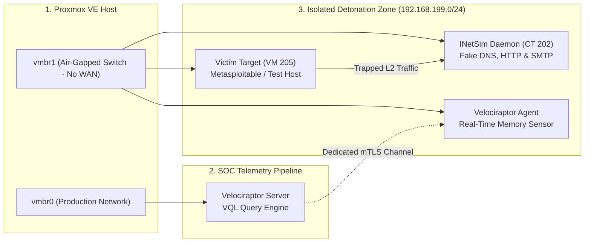

# 🛡️ Cyber DFIR Training Lab & Purple Team Automation

[](https://lessa-github.github.io/cyber-dfir-training-lab/)
[](https://attack.mitre.org)
[](https://docs.velociraptor.app)
[](https://lessa-github.github.io/gabriel-portfolio/)

Autonomous Digital Forensics, Incident Response (DFIR), and purple team adversarial emulation platform built inside an isolated Proxmox VE environment.

The lab provides safe malware detonation inside an **air-gapped sandbox (`vmbr1`) and validates 344 MITRE ATT&CK techniques** without relying on heavy Java or Elasticsearch SIEM clusters.

---

## ⚡ Engineering Highlight: Enterprise DFIR in 67 MB RAM

While conventional Wazuh, Elastic Security, or Splunk clusters require between **4 and 8 GB of RAM** just to keep the ingestion stack operational, this lab deploys a lean, high-velocity architecture:
* **Velociraptor Server:** Static Go binary compiled for Linux musl, running with an exact **67 MB physical RAM footprint**.
* **VQL (Velociraptor Query Language):** Live memory-speed anomaly hunting across endpoints, collecting only necessary forensic artifacts.
* **Storage Reduction:** Eliminates terabytes of verbose log indexing; artifacts are pulled on demand via declarative queries.

| Forensic Platform | Idle RAM Baseline | Average Host CPU | Monthly NVMe Disk I/O | SRE Hardware Efficiency |
| :--- | :---: | :---: | :---: | :---: |
| **Wazuh + OpenSearch** | ~6,200 MB | 12% – 25% | ~45 GB (JVM Indices) | Heavy SIEM Stack |
| **Splunk Enterprise** | ~4,800 MB | 10% – 18% | ~60 GB (Indexed Logs) | Enterprise Proprietary |
| **Velociraptor (Go musl)** | **67 MB** | **< 1.5%** | **< 2 GB (Raw DFIR)** | **98.9% Physical RAM Reduction** |

---

## 📐 Air-Gapped Sandbox Topology (`vmbr1`)



---

## 🎯 Purple Teaming & MITRE ATT&CK Coverage

The automated test harness executes atomic tests with guaranteed post-run cleanup:

| MITRE ATT&CK Tactic | Technique ID & Name | Forensic VQL Artifact |
| :--- | :--- | :--- |
| **Execution** | T1059.001 (PowerShell Obfuscated Commands) | `Generic.Client.ProcessTracker` |
| **Persistence** | T1547.001 (Registry Run Keys & Startup Folder) | `Windows.Sys.Autoruns` |
| **Privilege Escalation** | T1068 (Exploitation for Privilege Escalation) | `Linux.Sys.PrivilegeAudit` |
| **Defense Evasion** | T1070.004 (File Deletion & Timestomping) | `Windows.NTFS.MFT` / `Linux.Search.FileFinder` |
| **Credential Access** | T1003.001 (LSASS Process Memory Dumping) | `Windows.Detection.MemoryInjection` |
| **Discovery** | T1082 (System Information Discovery) | `Generic.System.Info` |

---

## 🛠️ CLI Orchestrator: `homelab-soc.py`

```text
===================================================================
  HOMELAB-SOC - Autonomous Incident Response & DFIR Orchestrator
===================================================================
Usage: ./homelab-soc [COMMAND] [ARGUMENTS]

Commands:
  hunt <vql_artifact>      Execute a forensic threat hunt across all endpoints
  simulate <mitre_id>      Trigger Atomic Red Team technique in air-gapped target
  verify <sigma_rule>      Validate if recent telemetry triggered a detection rule
  quarantine <client_id>   Isolate target endpoint at the kernel bridge layer

Options:
  --target-ct <id>         Specify target LXC or VM ID (default: test sandbox)
  --format <table|json>    Output presentation format
  --dry-run                Simulate execution without running atomic payload
  --help                   Display command options and forensic syntax
```

---

## 🌐 Live Technical Documentation

Explore the complete single-page interactive whitepaper with smooth section scrolling:

👉 **[https://lessa-github.github.io/cyber-dfir-training-lab/](https://lessa-github.github.io/cyber-dfir-training-lab/)**
