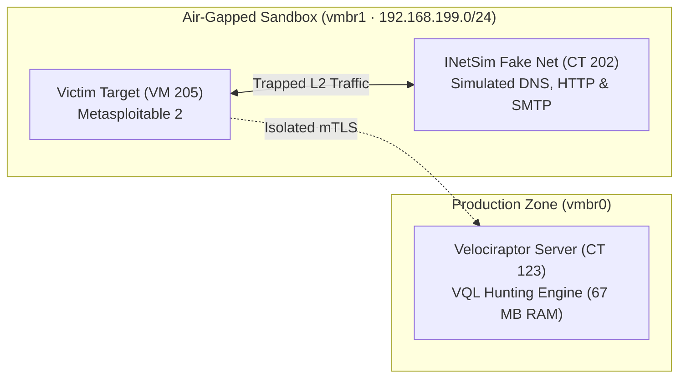

# 🛡️ Cyber DFIR Training Lab & Purple Team Automation

> **Author:** Gabriel Santa Rosa Lessa  
> **Timeline:** 2025 – Present (College Studies 2025 - Aug/2026 · Intensive Hands-on Aug/2026 - Present)  
> **Core Engine:** Velociraptor VQL (Static Go musl binary · 67 MB RAM)  
> **Testing Scope:** 344 MITRE ATT&CK Techniques with Automated Cleanup · Air-Gapped L2 Sandbox (`vmbr1`)

---

## 📋 Platform Overview :id=platform-overview

This repository documents an enterprise-grade Digital Forensics, Incident Response (DFIR), and automated adversary emulation platform architected within a lightweight, resource-bounded Proxmox VE homelab.

The platform allows safe detonating of malware inside an **air-gapped sandbox (`vmbr1`)** and executing **344 MITRE ATT&CK techniques** without depending on heavy Java or Elasticsearch SIEM clusters that monopolize host resources.

### Architectural Pillars:
* **Endpoint Telemetry in 67 MB RAM:** Velociraptor compiled in static Go replacing heavyweight 6 GB Elasticsearch stacks.
* **Deterministic L2 Isolation:** Completely air-gapped Linux bridge (`vmbr1` on `192.168.199.0/24`) with fake internet simulation (INetSim).
* **Automated Purple Teaming:** Atomic Red Team orchestration runner with guaranteed post-execution cleanup.
* **Declarative Threat Hunting:** Real-time memory and filesystem anomaly detection using Velociraptor Query Language (VQL).

---

## ⚡ DFIR with 67 MB RAM: The Benchmark :id=dfir-benchmark

Enterprise SIEMs like Wazuh, Elastic Security, and Splunk require substantial memory and disk overhead just to maintain the log ingestion pipeline. This lab adopts surgical on-demand endpoint querying:

| Forensic Platform | Idle RAM Baseline | Average Host CPU | Monthly NVMe Disk I/O | SRE Hardware Efficiency |
| :--- | :---: | :---: | :---: | :---: |
| **Wazuh + OpenSearch** | ~6,200 MB | 12% – 25% | ~45 GB (JVM Indices) | Heavy SIEM Stack |
| **Splunk Enterprise** | ~4,800 MB | 10% – 18% | ~60 GB (Indexed Logs) | Enterprise Proprietary |
| **Velociraptor (Go musl)** | **67 MB** | **< 1.5%** | **< 2 GB (Raw DFIR)** | **98.9% Physical RAM Reduction** |

Instead of indexing millions of harmless system events into an SSD-wearing database, the analyst queries live endpoint memory at native speed using VQL.

---

## 🧱 Air-Gapped Sandbox (vmbr1) :id=airgapped-sandbox



### Subnet Isolation Policy
* **`192.168.199.0/24`:** Dedicated to `vmbr1`. Has **no default gateway** and **no NAT forwarding rules**. Any malware payload attempting external command-and-control (C2) communication is permanently trapped inside the hypervisor Layer 2 boundary.

---

## 🎭 INetSim Traffic Simulation :id=inetsim-simulation

Modern malware samples execute sandbox evasion routines by checking for internet connectivity. The **INetSim** daemon fools executable payloads into revealing their multi-stage behavior:
* **Fake DNS (Port 53):** Resolves all queried domain names to `192.168.199.202`.
* **Fake HTTP / HTTPS (Ports 80/443):** Serves synthetic HTTP 200 OK responses with dummy file downloads.
* **Fake SMTP / IRC / NTP:** Emulates communication channels, prompting the malware to unpack its memory payload for Velociraptor inspection.

---

## 🎯 MITRE ATT&CK Coverage (344 Techniques) :id=mitre-attack

Our purple teaming pipeline executes atomic test payloads with guaranteed state cleanup:

| MITRE ATT&CK Tactic | Technique ID & Name | Forensic VQL Artifact |
| :--- | :--- | :--- |
| **Execution** | T1059.001 (PowerShell Obfuscated Commands) | `Generic.Client.ProcessTracker` |
| **Persistence** | T1547.001 (Registry Run Keys & Startup Folder) | `Windows.Sys.Autoruns` |
| **Privilege Escalation** | T1068 (Exploitation for Privilege Escalation) | `Linux.Sys.PrivilegeAudit` |
| **Defense Evasion** | T1070.004 (File Deletion & Timestomping) | `Windows.NTFS.MFT` / `Linux.Search.FileFinder` |
| **Credential Access** | T1003.001 (LSASS Process Memory Dumping) | `Windows.Detection.MemoryInjection` |
| **Discovery** | T1082 (System Information Discovery) | `Generic.System.Info` |

---

## 🔍 Custom VQL Threat Hunting Artifacts :id=vql-hunting

### 1. Hunting Unlinked Process Binaries (Process Hollowing / Masquerading)

```sql
name: Custom.Hunt.HiddenProcesses
description: Locates active running processes where the executable disk binary was unlinked or deleted.

sources:
  - query: |
      SELECT Pid, Ppid, Name, CommandLine, Exe, Username
      FROM pslist()
      WHERE Exe =~ "deleted" OR NOT Exe
```

### 2. Hunting Suspicious Persistence (Linux Systemd Services)

```sql
name: Custom.Hunt.SuspiciousSystemdUnits
description: Audits newly registered systemd units pointing to volatile storage (/tmp or /dev/shm).

sources:
  - query: |
      SELECT Name, Path, ServiceContent
      FROM systemd()
      WHERE ServiceContent =~ "(shm|tmp|nc|bash -i)"
```

---

## 🛠️ homelab-soc CLI Orchestrator :id=soc-cli

The command-line interface provides unified control over the incident response pipeline:

```text
===================================================================
  HOMELAB-SOC - Autonomous Incident Response & DFIR Orchestrator
===================================================================
Usage: ./homelab-soc [COMMAND] [ARGUMENTS]

Commands:
  hunt <vql_artifact>      Execute a forensic threat hunt across all endpoints
  simulate <mitre_id>      Trigger Atomic Red Team technique in air-gapped target
  verify <sigma_rule>      Validate if recent telemetry triggered a detection rule
  quarantine <client_id>   Isolate target endpoint at the kernel bridge layer

Options:
  --target-ct <id>         Specify target LXC or VM ID (default: test sandbox)
  --format <table|json>    Output presentation format
  --dry-run                Simulate execution without running atomic payload
  --help                   Display command options and forensic syntax
```

---

## 🔗 Connected Portals & Repositories :id=connected-portals

* 🏛️ **[Homelab Zero-Trust](https://lessa-github.github.io/homelab-zero-trust-infra/)** — Network Topology, Proxmox VE & SRE Hardening.
* 🧠 **[Sovereign AI Workspace](https://lessa-github.github.io/sovereign-ai-workspace/)** — Multi-Provider Gateway, Caveman Compression & Private Search.
* ⚰️ **[Homelab Graveyard & Lessons Learned](https://lessa-github.github.io/homelab-graveyard-and-lessons-learned/)** — SRE Post-Mortems on Decommissioned Stacks.
* 🌐 **[Gabriel Lessa Portfolio](https://lessa-github.github.io/gabriel-portfolio/)** — Cybersecurity Risk Management & Homelab Engineering.
* 🔒 **[Zero-Knowledge Secret Framework](https://github.com/Lessa-github/zero-knowledge-secret-framework)** — Ephemeral Memory Secret Injection Engine (Private).
