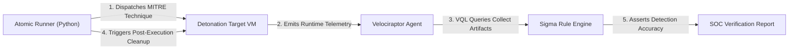

# 🎯 Purple Teaming & MITRE ATT&CK Matrix Coverage

Our Purple Teaming pipeline unites automated adversary simulation with continuous defensive validation.

---

## 📋 Atomic Red Team Execution Pipeline

The automated orchestration pipeline covers **344 enterprise techniques across the MITRE ATT&CK framework**:

### Representative Validated Techniques:
* **T1059.001 - PowerShell Execution:** Detection of obfuscated script blocks and Base64-encoded execution flags.
* **T1547.001 - Registry Run Keys & Persistence:** Interception of unauthorized autostart registry modifications and suspicious systemd unit creations.
* **T1003.001 - OS Credential Dumping:** Real-time alerting on unauthorized memory read handles targeting authentication daemons.
* **T1070.004 - File Timestomping:** Detection of deliberate file timestamp manipulation designed to evade timeline forensics.
