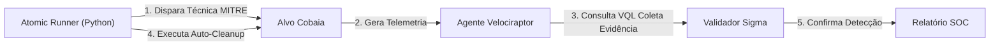

# 🎯 Purple Teaming & Cobertura MITRE ATT&CK

Nossa abordagem de Purple Teaming combina o ataque simulado com a validação defensiva imediata.

---

## 📋 Matriz de Testes com Atomic Red Team

A esteira de automação cobre **344 técnicas da matriz MITRE ATT&CK Enterprise**:

### Exemplos de Técnicas Validadas:
* **T1059.001 - PowerShell Execution:** Validação de processos com parâmetros codificados em Base64.
* **T1547.001 - Registry Run Keys:** Criação de chaves de persistência no registro do Windows / systemd units no Linux.
* **T1003.001 - OS Credential Dumping:** Tentativas de acesso direto à memória de processos sensíveis.
* **T1070.004 - Timestomping:** Manipulação deliberada de datas de modificação de arquivos para enganar peritos.
